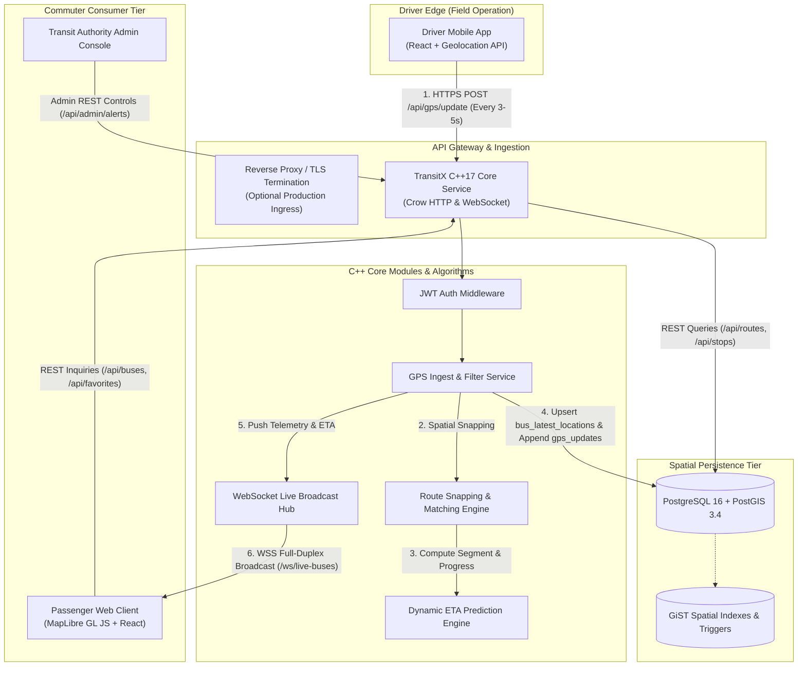
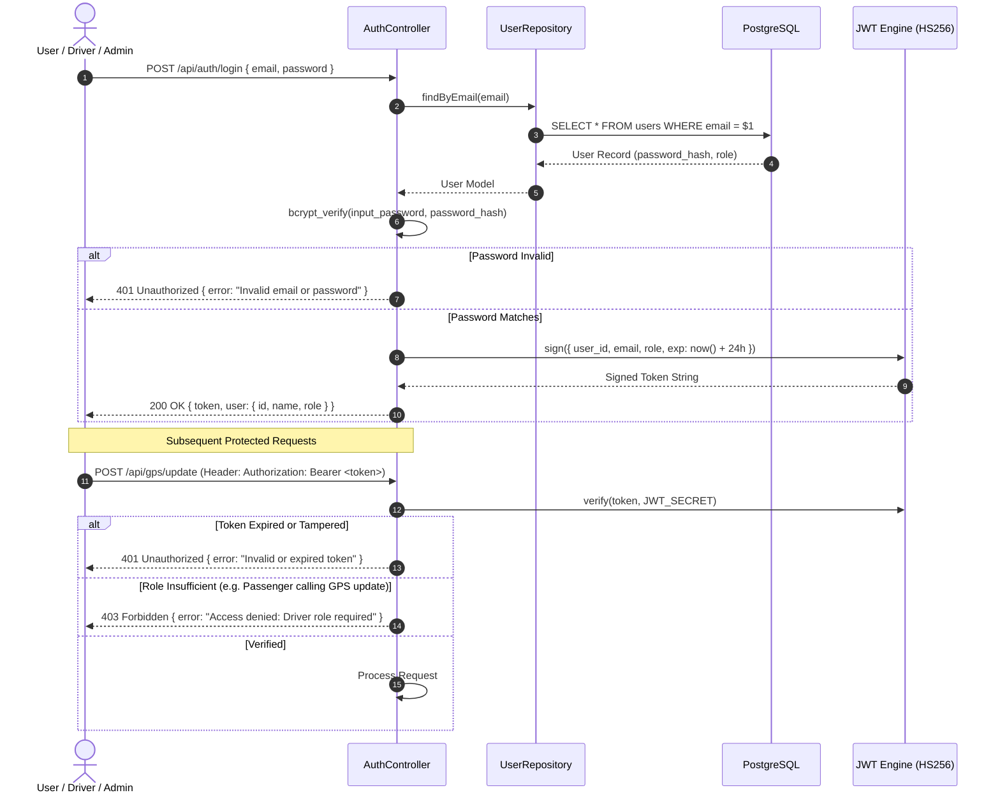
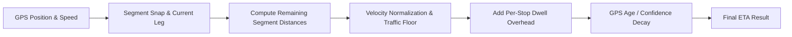

# TransitX — System Architecture Specification

## Table of Contents
1. [Architecture Overview](#1-architecture-overview)
2. [Component Specifications](#2-component-specifications)
   - [2.1 C++17 Backend Service (Crow HTTP & WebSockets)](#21-c17-backend-service-crow-http--websockets)
   - [2.2 Spatial Database (PostgreSQL 16 + PostGIS 3.4)](#22-spatial-database-postgresql-16--postgis-34)
   - [2.3 Passenger Web Application (React 18 + Vite + MapLibre GL)](#23-passenger-web-application-react-18--vite--maplibre-gl)
   - [2.4 Driver Mobile Telemetry Application](#24-driver-mobile-telemetry-application)
3. [End-to-End Data Flows](#3-end-to-end-data-flows)
   - [3.1 Telemetry Ingestion Pipeline (Driver GPS → Frontend Map)](#31-telemetry-ingestion-pipeline-driver-gps--frontend-map)
   - [3.2 Authentication & Authorization Lifecycle (JWT)](#32-authentication--authorization-lifecycle-jwt)
   - [3.3 Real-Time WebSocket Streaming Engine](#33-real-time-websocket-streaming-engine)
4. [Algorithmic Core](#4-algorithmic-core)
   - [4.1 Haversine Great-Circle Distance Engine](#41-haversine-great-circle-distance-engine)
   - [4.2 Route Snapping & Segment Matching Algorithm](#42-route-snapping--segment-matching-algorithm)
   - [4.3 Dynamic Estimated Time of Arrival (ETA) Pipeline](#43-dynamic-estimated-time-of-arrival-eta-pipeline)
5. [Security & Network Topology](#5-security--network-topology)

---

## 1. Architecture Overview

TransitX is constructed on a decoupled, reactive, microservice-inspired architecture designed to deliver sub-second bus telemetry propagation while sustaining high concurrent read throughput for urban commuters.

### High-Level Architectural Diagram



---

## 2. Component Specifications

### 2.1 C++17 Backend Service (Crow HTTP & WebSockets)

The backend is built in standard C++17 to maximize processing speed, memory efficiency, and deterministic latency during high-frequency spatial vector calculations.

- **Crow Framework Core**: A high-performance, header-first C++ micro-framework providing multi-threaded HTTP request routing, static file dispatching, middleware hooks, and RFC 6455 compliant WebSocket server implementation.
- **Connection Pooling**: Managed via `libpqxx` (official C++ client library for PostgreSQL). Pre-warmed persistent socket pools eliminate TCP and TLS handshake penalties during database transactions.
- **JSON Serialization**: High-speed schema serialization and deserialization via `nlohmann/json`.
- **Stateless Concurrency Model**: Workers handle HTTP transactions asynchronously across an internal thread pool without blocking on spatial calculations.

### 2.2 Spatial Database (PostgreSQL 16 + PostGIS 3.4)

PostgreSQL coupled with the PostGIS extension provides the foundational geospatial database for TransitX:

- **Spatial Geometries**: Bus locations and transit stops are stored as `GEOGRAPHY(Point, 4326)` representing WGS 84 ellipsoidal coordinates (longitude, latitude).
- **GiST Indexing**: Generalized Search Tree (GiST) indexes are established across all spatial geography columns (`stops.location`, `bus_latest_locations.location`) to yield $O(\log N)$ performance on range and radial proximity searches.
- **Synchronous Triggers**: Automated database triggers (`fn_stops_set_location` and `fn_bus_latest_locations_set_location`) listen to `BEFORE INSERT OR UPDATE` events on `(latitude, longitude)` and synthesize native binary geography points via `ST_SetSRID(ST_MakePoint(lon, lat), 4326)`.
- **Relational Integrity**: Strict foreign key constraints with cascading deletions protect user favorites and route stops while maintaining immutable telemetry logs in `gps_updates`.

### 2.3 Passenger Web Application (React 18 + Vite + MapLibre GL)

The commuter portal delivers a responsive desktop and mobile browser experience:

- **MapLibre GL JS**: Renders client-side vector map tiles using WebGL shaders. Bus markers smoothly interpolate along GPS vector updates to mitigate visual stutter between telemetry intervals.
- **Custom React Hooks**:
  - `useWebSocket`: Manages automatic connection re-establishment, exponential backoff, topic multiplexing, and message heartbeat verification.
  - `useBuses` & `useRoutes`: Integrates client-side caching, filtering, and query state synchronization.
- **Adaptive Layout**: Features interactive route drawers, stop lookup sheets, real-time arrival countdowns, and active service disruption banners.

### 2.4 Driver Mobile Telemetry Application

A dedicated, lightweight Progressive Web Application (PWA) designed specifically for transit operators running on mobile devices:

- **HTML5 Geolocation Pipeline**: Binds directly to `navigator.geolocation.watchPosition` with `enableHighAccuracy: true`, `maximumAge: 0`, and `timeout: 10000`.
- **Client-Side Noise Filtering**: Telemetry points with horizontal accuracy errors exceeding 200 meters ($\text{accuracy} > 200\text{m}$) are discarded before dispatch to prevent multipath distortion and false route snapping.
- **State Preservation & Background Management**: Monitors `document.visibilitychange` events and informs the driver if operating system power management throttles location sensors when the screen locks or tabs switch.
- **Trip Lifecycle Controls**: Direct interface for the driver to trigger `START`, `PAUSE`, `RESUME`, and `END` trip states, ensuring passenger ETA models do not calculate arrival estimations for off-duty or depot-bound buses.

---

## 3. End-to-End Data Flows

### 3.1 Telemetry Ingestion Pipeline (Driver GPS → Frontend Map)

```
[Driver Device]
       │
       ▼ (1) navigator.geolocation.watchPosition() (lat, lng, speed, heading, accuracy)
[Driver App Service]
       │
       ▼ (2) Filter: accuracy <= 200m
       │
       ▼ (3) POST /api/gps/update { bus_id, trip_id, latitude, longitude, speed, heading, accuracy }
[Crow Backend: GpsController]
       │
       ├──► (4) AuthMiddleware: Validate Driver Bearer JWT
       │
       ├──► (5) Spatial Pipeline:
       │        ├── RouteMatcher: Project (lat, lng) onto Route polyline
       │        └── EtaService: Compute remaining stop distances & arrival times
       │
       ├──► (6) Database Pipeline (Async / Thread Pool):
       │        ├── INSERT INTO gps_updates (...)
       │        └── UPSERT INTO bus_latest_locations (...)
       │
       └──► (7) WebSocket LiveHandler:
                │
                ▼ Broadcast JSON payload to active /ws/live-buses subscribers
[Passenger Client: useWebSocket Hook]
       │
       ▼ (8) Update GeoJSON Source & Smoothly Animate Marker along Heading
[MapLibre GL Map View]
```

### 3.2 Authentication & Authorization Lifecycle (JWT)



### 3.3 Real-Time WebSocket Streaming Engine

1. **Connection Upgrade**: Commuter web applications establish a WebSocket handshake at `ws://<backend-host>:8080/ws/live-buses`.
2. **Channel Subscription**: Clients can listen globally or transmit an explicit subscription frame to monitor a targeted bus or route:
   ```json
   { "action": "subscribe", "route_id": 1 }
   ```
3. **Broadcast Fan-Out**: When an authenticated driver publishes a valid coordinate to `/api/gps/update`, the internal `WebSocketHub` loops through its thread-safe registry of connected sessions and dispatches an immediate telemetry event:
   ```json
   {
     "type": "BUS_LOCATION_UPDATE",
     "bus_id": 1,
     "route_id": 1,
     "latitude": 30.3174,
     "longitude": 78.0335,
     "speed": 26.4,
     "heading": 178.5,
     "accuracy": 4.2,
     "updated_at": "2026-11-17T10:30:15Z"
   }
   ```
4. **Dead Socket Pruning**: On socket heartbeat failure (`ping`/`pong` timeout) or client disconnection, the backend instantly removes the session pointer from memory to prevent socket descriptor leaks.

---

## 4. Algorithmic Core

### 4.1 Haversine Great-Circle Distance Engine

Because transit routing takes place on an oblate spheroid, TransitX relies on the **Haversine formula** to compute spherical distance between coordinate pairs $( \phi_1, \lambda_1 )$ and $( \phi_2, \lambda_2 )$:

$$\Delta\phi = \phi_2 - \phi_1, \quad \Delta\lambda = \lambda_2 - \lambda_1$$

$$a = \sin^2\left(\frac{\Delta\phi}{2}\right) + \cos(\phi_1)\cos(\phi_2)\sin^2\left(\frac{\Delta\lambda}{2}\right)$$

$$c = 2 \cdot \operatorname{atan2}\left(\sqrt{a}, \sqrt{1 - a}\right)$$

$$d = R \cdot c$$

Where:
- $\phi$ is latitude in radians.
- $\lambda$ is longitude in radians.
- $R$ is the Earth's volumetric mean radius ($R \approx 6,371,000 \text{ meters}$).

The C++ implementation operates in $O(1)$ constant time with SIMD compiler auto-vectorization enabled.

### 4.2 Route Snapping & Segment Matching Algorithm

Raw GPS signals exhibit multipath reflection, atmospheric distortion, and GPS chip jitter. The **Route Matcher Engine** aligns GPS fixes to the defined route topology:

```
  Stop A (x1, y1) ──────────────────────────────────────────► Stop B (x2, y2)
                              ▲
                              │ Orthogonal Projection Segment
                              │
                      [ Raw Bus Fix ] (px, py)
```

1. **Candidate Polyline Extraction**: When a bus transmits telemetry, the algorithm loads the ordered stop sequence $S = [s_1, s_2, \dots, s_n]$ for the assigned route.
2. **Orthogonal Segment Projection**: For each segment between consecutive stops $(s_i, s_{i+1})$, the algorithm projects the raw bus point $P$ onto segment line $\vec{AB}$.
   - Let $\vec{u} = B - A$ and $\vec{v} = P - A$.
   - The scalar projection parameter $t$ is calculated:
     $$t = \frac{\vec{v} \cdot \vec{u}}{\|\vec{u}\|^2}$$
   - Clamped to $t \in [0, 1]$ to restrict the match to the physical segment bounds:
     $$P_{\text{proj}} = A + t \cdot \vec{u}$$
3. **Cross-Track Error Minimization**: The distance $d_i = \operatorname{Haversine}(P, P_{\text{proj}})$ is evaluated across all segments. The segment yielding the minimum cross-track error within a 150m tolerance threshold is confirmed as the bus's current location.
4. **Progress Determination**: From the snapped segment index $i$ and factor $t$, the system identifies all subsequent remaining downstream stops $[s_{i+1}, \dots, s_n]$.

### 4.3 Dynamic Estimated Time of Arrival (ETA) Pipeline

TransitX uses a multi-factor ETA prediction algorithm that accounts for instantaneous speed, minimum and maximum urban transit velocities, dwell delays, and telemetry decay:



#### Step 1: Distance Along Route
The remaining physical distance $D_{\text{rem}}$ to target stop $s_k$ is the sum of the distance from the bus's snapped coordinate to the end of the current segment, plus the cumulative segment lengths to $s_k$:
$$D_{\text{rem}} = \operatorname{Haversine}(P_{\text{proj}}, s_{i+1}) + \sum_{j = i+1}^{k-1} \operatorname{Haversine}(s_j, s_{j+1})$$

#### Step 2: Velocity Bounds Normalization
Urban buses encounter traffic signals, pedestrian crossings, and congestion. Raw instantaneous velocity $v_{\text{inst}}$ can drop to zero at red lights, which would cause standard $d/v$ formulas to divide by zero or predict infinite delays. Velocity is normalized as:
$$v_{\text{eff}} = \operatorname{clamp}(v_{\text{inst}}, v_{\text{min}}, v_{\text{max}})$$
- $v_{\text{min}} = 5.0 \text{ km/h}$ (ensures progress during stop-and-go congestion).
- $v_{\text{max}} = 60.0 \text{ km/h}$ (regulates downhill or arterial speed surges).
- If the bus has been stationary ($v_{\text{inst}} < 1.0 \text{ km/h}$) for $\ge 30$ seconds, the algorithm substitutes the historical route average velocity ($v_{\text{hist}} \approx 22.0 \text{ km/h}$).

#### Step 3: Dwell Time Calculation
Each intermediate bus stop introduces dwell time for passenger boarding and alighting. If there are $m$ intermediate stops between the vehicle and target stop $s_k$:
$$T_{\text{dwell}} = \sum_{j=i+1}^{k-1} \tau_{\text{dwell}}(s_j)$$
Where default $\tau_{\text{dwell}} = 30 \text{ seconds}$ (or 60 seconds at major transit terminals).

#### Step 4: Total Travel Time & Timestamp Formulation
$$T_{\text{travel\_seconds}} = \left(\frac{D_{\text{rem}}}{v_{\text{eff}}}\right) \cdot 3600 + T_{\text{dwell}}$$
$$\text{ETA} = \text{CurrentTime} + T_{\text{travel\_seconds}}$$

#### Step 5: Confidence Scoring
A confidence metric $C \in [0.0, 1.0]$ is assigned based on GPS latency $\Delta t_{\text{gps}} = \text{now}() - t_{\text{telemetry}}$:
- $\Delta t \le 15\text{s} \implies C = 1.0$ (High confidence)
- $15\text{s} < \Delta t \le 60\text{s} \implies C = 0.75$ (Moderate confidence)
- $60\text{s} < \Delta t \le 300\text{s} \implies C = 0.40$ (Degraded / stale telemetry)
- $\Delta t > 300\text{s} \implies C = 0.0$ (Trip marked inactive/unreliable)

---

## 5. Security & Network Topology

```
                       [ Public Internet ]
                                │
                                ▼ Port 443 (HTTPS / WSS)
                 ┌─────────────────────────────┐
                 │    Reverse Proxy / Firewall │
                 │      (Rate Limiting & TLS)  │
                 └──────────────┬──────────────┘
                                │ Internal Forwarding
                 ┌──────────────▼──────────────┐
                 │    TransitX C++ Backend     │
                 │         Port 8080           │
                 └──────────────┬──────────────┘
                                │ Isolated Docker Network
                 ┌──────────────▼──────────────┐
                 │    PostgreSQL + PostGIS     │
                 │         Port 5432           │
                 └─────────────────────────────┘
```

1. **Transport Layer Security (TLS)**: All external edge communication (Driver GPS uploads, Passenger REST requests, and WebSocket channels) is secured over TLS 1.3 / HTTPS.
2. **Stateless Credential Verification**: User credentials are encrypted at rest using bcrypt with a computational work factor of 12. Authentication tokens use standard HMAC-SHA256 (HS256) signatures.
3. **Database Network Isolation**: The PostgreSQL container is isolated within an internal bridge network; only the backend container communicates with port 5432 in production configurations.
4. **Input Sanitization & Parameterized Queries**: All database queries executed via `libpqxx` utilize parameterized prepared statements, preventing SQL injection vulnerabilities.
