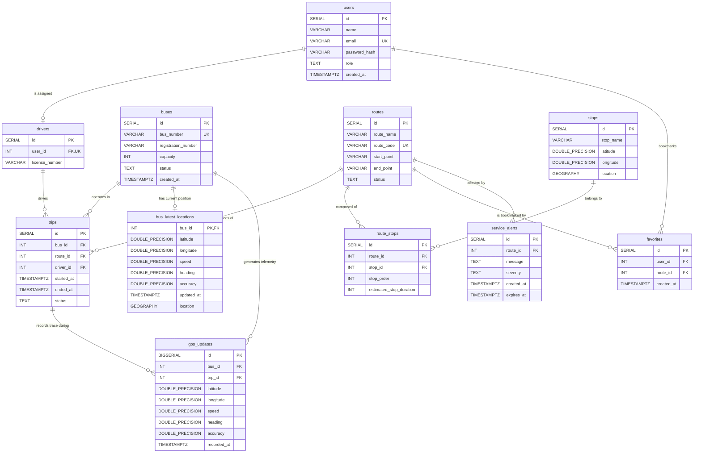

# TransitX — Database Architecture & PostGIS Specification

This document provides a comprehensive technical reference for the TransitX persistence tier, covering the relational schema, entity relationships, PostGIS spatial extensions, indexes, triggers, and demonstration seed datasets.

---

## Table of Contents

1. [Entity-Relationship Diagram](#1-entity-relationship-diagram)
2. [Database Schema Reference](#2-database-schema-reference)
   - [users](#21-users)
   - [buses](#22-buses)
   - [drivers](#23-drivers)
   - [routes](#24-routes)
   - [stops](#25-stops)
   - [route_stops](#26-route_stops)
   - [trips](#27-trips)
   - [gps_updates](#28-gps_updates)
   - [bus_latest_locations](#29-bus_latest_locations)
   - [favorites](#210-favorites)
   - [service_alerts](#211-service_alerts)
3. [Spatial Architecture & PostGIS Implementation](#3-spatial-architecture--postgis-implementation)
   - [3.1 Coordinate Reference System (SRID 4326)](#31-coordinate-reference-system-srid-4326)
   - [3.2 Geography vs. Geometry Types](#32-geography-vs-geometry-types)
   - [3.3 Automated Geography Triggers](#33-automated-geography-triggers)
   - [3.4 Spatial Proximity & Radial Queries](#34-spatial-proximity--radial-queries)
4. [Indexing Strategy](#4-indexing-strategy)
5. [Seed & Demonstration Data](#5-seed--demonstration-data)
   - [5.1 User Accounts](#51-user-accounts)
   - [5.2 Fleet Vehicles](#52-fleet-vehicles)
   - [5.3 Dehradun Transit Routes & Stops](#53-dehradun-transit-routes--stops)

---

## 1. Entity-Relationship Diagram



---

## 2. Database Schema Reference

### 2.1 users
Stores application credentials and system roles.

| Column | Type | Constraints | Description |
| :--- | :--- | :--- | :--- |
| `id` | `SERIAL` | `PRIMARY KEY` | Unique synthetic identifier |
| `name` | `VARCHAR` | `NOT NULL` | Full display name of user |
| `email` | `VARCHAR` | `NOT NULL, UNIQUE` | Unique email address used for login |
| `password_hash` | `VARCHAR` | `NOT NULL` | Bcrypt password hash (cost factor 12) |
| `role` | `TEXT` | `NOT NULL, CHECK (role IN ('passenger', 'driver', 'admin'))` | User permission role |
| `created_at` | `TIMESTAMPTZ`| `DEFAULT NOW()` | Record insertion timestamp |

### 2.2 buses
Defines transit vehicle fleet assets.

| Column | Type | Constraints | Description |
| :--- | :--- | :--- | :--- |
| `id` | `SERIAL` | `PRIMARY KEY` | Unique bus vehicle identifier |
| `bus_number` | `VARCHAR` | `NOT NULL, UNIQUE` | Internal fleet identifier (e.g. `UK07PA7001`) |
| `registration_number`| `VARCHAR` | `NULLABLE` | Official government motor vehicle plate |
| `capacity` | `INT` | `NULLABLE` | Maximum passenger seating capacity |
| `status` | `TEXT` | `DEFAULT 'inactive'` | Fleet status: `active`, `inactive`, `maintenance` |
| `created_at` | `TIMESTAMPTZ`| `DEFAULT NOW()` | Vehicle onboarding timestamp |

### 2.3 drivers
Relates system user profiles to transit driver credentials.

| Column | Type | Constraints | Description |
| :--- | :--- | :--- | :--- |
| `id` | `SERIAL` | `PRIMARY KEY` | Driver profile record ID |
| `user_id` | `INT` | `NOT NULL, UNIQUE, REFERENCES users(id)` | Associated user account |
| `license_number` | `VARCHAR` | `NOT NULL` | Government commercial driver's license ID |

### 2.4 routes
Defines public transit route corridors.

| Column | Type | Constraints | Description |
| :--- | :--- | :--- | :--- |
| `id` | `SERIAL` | `PRIMARY KEY` | Unique route ID |
| `route_name` | `VARCHAR` | `NOT NULL` | Descriptive name (e.g., `Clock Tower - ISBT`) |
| `route_code` | `VARCHAR` | `NOT NULL, UNIQUE` | Public route code (e.g., `DR001`) |
| `start_point` | `VARCHAR` | `NULLABLE` | Name of origin terminus |
| `end_point` | `VARCHAR` | `NULLABLE` | Name of destination terminus |
| `status` | `TEXT` | `DEFAULT 'active'` | Operational status: `active`, `suspended` |

### 2.5 stops
Physical transit stops with spatial geospatial coordinates.

| Column | Type | Constraints | Description |
| :--- | :--- | :--- | :--- |
| `id` | `SERIAL` | `PRIMARY KEY` | Unique stop ID |
| `stop_name` | `VARCHAR` | `NOT NULL` | Human-readable bus stop name |
| `latitude` | `DOUBLE PRECISION`| `NOT NULL` | WGS 84 Latitude in decimal degrees |
| `longitude` | `DOUBLE PRECISION`| `NOT NULL` | WGS 84 Longitude in decimal degrees |
| `location` | `GEOGRAPHY(Point, 4326)`| `NULLABLE` | Spatial geography point auto-populated by trigger |

### 2.6 route_stops
Ordered sequence of bus stops comprising a given route.

| Column | Type | Constraints | Description |
| :--- | :--- | :--- | :--- |
| `id` | `SERIAL` | `PRIMARY KEY` | Sequence row identifier |
| `route_id` | `INT` | `REFERENCES routes(id) ON DELETE CASCADE`| Route foreign key |
| `stop_id` | `INT` | `REFERENCES stops(id) ON DELETE CASCADE` | Stop foreign key |
| `stop_order` | `INT` | `NOT NULL` | Sequential position of stop along route (1..N) |
| `estimated_stop_duration`| `INT` | `DEFAULT 30` | Scheduled dwell duration at stop in seconds |
| *Composite Constraint*| — | `UNIQUE (route_id, stop_order)` | Enforces unique sequence ordering per route |

### 2.7 trips
Active or historical driving sessions linking a vehicle, route, and driver.

| Column | Type | Constraints | Description |
| :--- | :--- | :--- | :--- |
| `id` | `SERIAL` | `PRIMARY KEY` | Trip identifier |
| `bus_id` | `INT` | `REFERENCES buses(id)` | Vehicle assigned to trip |
| `route_id` | `INT` | `REFERENCES routes(id)` | Route being executed |
| `driver_id` | `INT` | `REFERENCES drivers(id)` | Driver operating the vehicle |
| `started_at` | `TIMESTAMPTZ`| `NULLABLE` | Trip initiation timestamp |
| `ended_at` | `TIMESTAMPTZ`| `NULLABLE` | Trip termination timestamp |
| `status` | `TEXT` | `DEFAULT 'scheduled'`| `scheduled`, `in_progress`, `paused`, `completed`, `cancelled` |

### 2.8 gps_updates
Immutable append-only time-series log of all raw GPS fixes.

| Column | Type | Constraints | Description |
| :--- | :--- | :--- | :--- |
| `id` | `BIGSERIAL` | `PRIMARY KEY` | Sequential 64-bit log sequence ID |
| `bus_id` | `INT` | `REFERENCES buses(id)` | Reporting bus vehicle |
| `trip_id` | `INT` | `REFERENCES trips(id)` | Active trip at time of transmission |
| `latitude` | `DOUBLE PRECISION`| `NOT NULL` | Raw latitude reported by device |
| `longitude` | `DOUBLE PRECISION`| `NOT NULL` | Raw longitude reported by device |
| `speed` | `DOUBLE PRECISION`| `NULLABLE` | Ground speed in km/h or m/s |
| `heading` | `DOUBLE PRECISION`| `NULLABLE` | Direction of motion in degrees (0..359.9) |
| `accuracy` | `DOUBLE PRECISION`| `NULLABLE` | Horizontal 68% confidence radius in meters |
| `recorded_at` | `TIMESTAMPTZ`| `DEFAULT NOW()` | Device telemetry recording timestamp |

### 2.9 bus_latest_locations
Materialized snapshot cache holding the most recent telemetry fix for each bus.

| Column | Type | Constraints | Description |
| :--- | :--- | :--- | :--- |
| `bus_id` | `INT` | `PRIMARY KEY, REFERENCES buses(id)` | Single record per vehicle |
| `latitude` | `DOUBLE PRECISION`| `NOT NULL` | Latest latitude fix |
| `longitude` | `DOUBLE PRECISION`| `NOT NULL` | Latest longitude fix |
| `speed` | `DOUBLE PRECISION`| `NULLABLE` | Latest instantaneous velocity |
| `heading` | `DOUBLE PRECISION`| `NULLABLE` | Latest vehicle compass bearing |
| `accuracy` | `DOUBLE PRECISION`| `NULLABLE` | Latest GPS accuracy radius |
| `updated_at` | `TIMESTAMPTZ`| `DEFAULT NOW()` | Timestamp of last received packet |
| `location` | `GEOGRAPHY(Point, 4326)`| `NULLABLE` | PostGIS spatial point auto-synced by trigger |

### 2.10 favorites
Commuter saved routes for rapid access.

| Column | Type | Constraints | Description |
| :--- | :--- | :--- | :--- |
| `id` | `SERIAL` | `PRIMARY KEY` | Bookmark record identifier |
| `user_id` | `INT` | `REFERENCES users(id) ON DELETE CASCADE`| User who bookmarked the route |
| `route_id` | `INT` | `REFERENCES routes(id) ON DELETE CASCADE`| The bookmarked route |
| `created_at` | `TIMESTAMPTZ`| `DEFAULT NOW()` | Date bookmark was created |
| *Composite Constraint*| — | `UNIQUE (user_id, route_id)` | Prevents duplicate user bookmarks |

### 2.11 service_alerts
Transit authority alerts and detour bulletins.

| Column | Type | Constraints | Description |
| :--- | :--- | :--- | :--- |
| `id` | `SERIAL` | `PRIMARY KEY` | Alert notification ID |
| `route_id` | `INT` | `NULLABLE, REFERENCES routes(id)` | Target route (or `NULL` for network-wide) |
| `message` | `TEXT` | `NOT NULL` | Detailed disruption announcement |
| `severity` | `TEXT` | `DEFAULT 'info'` | Severity level: `info`, `warning`, `critical` |
| `created_at` | `TIMESTAMPTZ`| `DEFAULT NOW()` | Alert publication timestamp |
| `expires_at` | `TIMESTAMPTZ`| `NULLABLE` | Expiration timestamp for automatic alert retirement |

---

## 3. Spatial Architecture & PostGIS Implementation

### 3.1 Coordinate Reference System (SRID 4326)
TransitX standardizes on **EPSG:4326 (WGS 84)**. Coordinates are expressed as `(longitude, latitude)` in degrees, representing ellipsoidal coordinates matching GPS satellite systems.

### 3.2 Geography vs. Geometry Types
TransitX explicitly employs the PostGIS `GEOGRAPHY` type rather than planar `GEOMETRY`:
- `GEOMETRY` computes distances on a Cartesian plane using flat Euclidean math ($\sqrt{\Delta x^2 + \Delta y^2}$). Across urban spans, planar projections introduce geographic distortion.
- `GEOGRAPHY` automatically computes great-circle distances along the WGS 84 reference ellipsoid. Distance queries return native values in **meters**, removing the need for spherical trigonometric projection in raw SQL.

### 3.3 Automated Geography Triggers

To decouple API ingestion from manual PostGIS geometric constructor formatting, PL/pgSQL triggers automatically compute the binary `GEOGRAPHY` column whenever `(latitude, longitude)` are inserted or updated:

```sql
-- Trigger Function for stops
CREATE OR REPLACE FUNCTION fn_stops_set_location()
RETURNS TRIGGER AS $$
BEGIN
    NEW.location := ST_SetSRID(ST_MakePoint(NEW.longitude, NEW.latitude), 4326)::geography;
    RETURN NEW;
END;
$$ LANGUAGE plpgsql;

CREATE TRIGGER trg_stops_set_location
    BEFORE INSERT OR UPDATE OF latitude, longitude ON stops
    FOR EACH ROW
    EXECUTE FUNCTION fn_stops_set_location();

-- Trigger Function for bus_latest_locations
CREATE OR REPLACE FUNCTION fn_bus_latest_locations_set_location()
RETURNS TRIGGER AS $$
BEGIN
    NEW.location := ST_SetSRID(ST_MakePoint(NEW.longitude, NEW.latitude), 4326)::geography;
    RETURN NEW;
END;
$$ LANGUAGE plpgsql;

CREATE TRIGGER trg_bus_latest_locations_set_location
    BEFORE INSERT OR UPDATE OF latitude, longitude ON bus_latest_locations
    FOR EACH ROW
    EXECUTE FUNCTION fn_bus_latest_locations_set_location();
```

> [!IMPORTANT]
> Note the parameter ordering in `ST_MakePoint(longitude, latitude)`: PostGIS follows $(X, Y)$ coordinate ordering where $X = \text{longitude}$ and $Y = \text{latitude}$.

### 3.4 Spatial Proximity & Radial Queries

TransitX leverages native PostGIS operators for fast spatial querying:

#### Finding Stops Near a Coordinate
To find all stops within $R$ meters of a commuter's current coordinate:
```sql
SELECT 
    id, stop_name, latitude, longitude,
    ST_Distance(location, ST_SetSRID(ST_MakePoint($1, $2), 4326)::geography) AS distance_meters
FROM stops
WHERE ST_DWithin(location, ST_SetSRID(ST_MakePoint($1, $2), 4326)::geography, $3)
ORDER BY distance_meters ASC
LIMIT 10;
```
Here `$1` is longitude, `$2` is latitude, and `$3` is radius in meters. The `ST_DWithin` predicate utilizes the GiST spatial index.

---

## 4. Indexing Strategy

| Index Name | Table | Type | Columns / Expressions | Performance Purpose |
| :--- | :--- | :--- | :--- | :--- |
| `idx_gps_updates_bus_recorded` | `gps_updates` | B-tree | `(bus_id, recorded_at)` | Accelerates trip replay and trajectory queries |
| `idx_gps_updates_trip` | `gps_updates` | B-tree | `(trip_id)` | Fetches complete GPS breadcrumb trail for completed trips |
| `idx_trips_bus` | `trips` | B-tree | `(bus_id)` | Fast lookup of active vehicle assignments |
| `idx_trips_driver` | `trips` | B-tree | `(driver_id)` | Driver dashboard query for currently active trip |
| `idx_trips_status` | `trips` | B-tree | `(status)` | Filters active trips (`in_progress`) from archived trips |
| `idx_bus_latest_locations_geo` | `bus_latest_locations` | **GiST** | `(location)` | Spatial range queries & bounding box filtering |
| `idx_stops_geo` | `stops` | **GiST** | `(location)` | Sub-millisecond `ST_DWithin` commuter proximity lookups |
| `idx_route_stops_route` | `route_stops` | B-tree | `(route_id)` | Ordered stop reconstruction for polyline maps |
| `idx_service_alerts_route_exp` | `service_alerts` | B-tree | `(route_id, expires_at)`| Active advisory filtering (`expires_at > NOW()`) |

---

## 5. Seed & Demonstration Data

The seed dataset is located at [`database/seeds/seed_data.sql`](file:///d:/TransitX/database/seeds/seed_data.sql) and reflects real geographic landmarks in **Dehradun, Uttarakhand, India**.

### 5.1 User Accounts
All seed accounts have the default password: `password123`.
- **System Administrator**: `admin@transitx.com` (`role: admin`)
- **Transit Drivers**:
  - `driver1@demo.com` — Suresh Panwar (License: `UK-DL-2020-001234`)
  - `driver2@demo.com` — Manoj Bisht (License: `UK-DL-2019-005678`)
  - `driver3@demo.com` — Deepak Thapa (License: `UK-DL-2021-009012`)
  - `driver4@demo.com` — Rajesh Gusain (License: `UK-DL-2018-003456`)
- **Commuters**:
  - `pass1@demo.com` — Amit Sharma
  - `pass2@demo.com` — Priya Rawat
  - `pass3@demo.com` — Rahul Negi

### 5.2 Fleet Vehicles
8 buses registered with Uttarakhand RTO plates (`UK-07-PA` series):
- `UK07PA7001` (Capacity: 40, Active)
- `UK07PA7002` (Capacity: 42, Active)
- `UK07PA7003` (Capacity: 44, Active)
- `UK07PA7004` (Capacity: 48, Active)
- `UK07PA7005` (Capacity: 50, Active)
- `UK07PA7006` (Capacity: 52, Inactive)
- `UK07PA7007` (Capacity: 54, Inactive)
- `UK07PA7008` (Capacity: 56, Active)

### 5.3 Dehradun Transit Routes & Stops

| Code | Route Name | Origin | Destination | Total Stops |
| :---: | :--- | :--- | :--- | :---: |
| `DR001` | Demo: Clock Tower - ISBT | Clock Tower | ISBT Dehradun | 6 stops |
| `DR002` | Demo: Rajpur Road - Mussoorie | Rajpur Road | Mussoorie Library Chowk | 6 stops |
| `DR003` | Demo: Clement Town - Ballupur | Clement Town | Ballupur Chowk | 6 stops |
| `DR004` | Demo: Rispana - Premnagar | Rispana Bridge | Premnagar | 5 stops |
| `DR005` | Demo: Survey Chowk - Pacific Mall | Survey Chowk | Pacific Mall | 6 stops |

All stop coordinates reflect real-world GPS coordinates in the Dehradun valley, providing authentic map rendering and route geometries out of the box.
